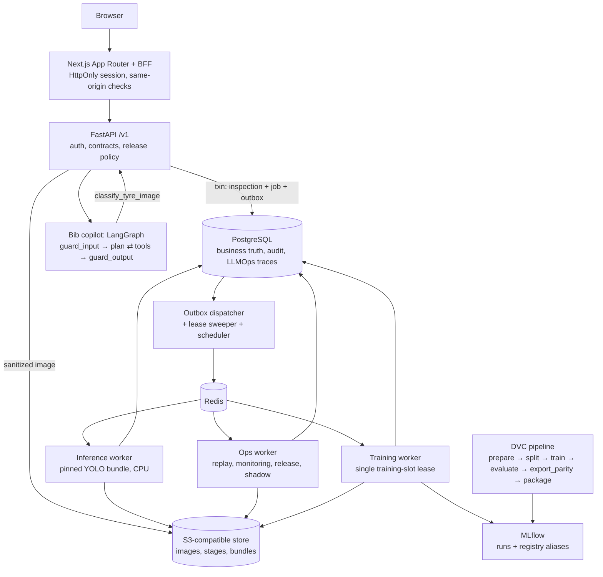

<p align="center">
  
</p>

<p align="center">
  <a href="https://github.com/arav7781/TREADOPS/actions/workflows/ci.yml"></a>
  
  
  
  
</p>

# TreadOps — casing circularity with benchmarked vision models, governed MLOps and a guarded copilot

TreadOps is a **tyre quality-inspection platform**. A photo or short video of a tyre gets a verdict,
**damaged or not damaged**, from the serving image classifier (ConvNeXt-Tiny since 2026-10-24, chosen by a
benchmark against Ultralytics YOLO26 n/s/m; both families run through the same pipeline), with an "expert check"
flag when the model is uncertain or the image is poor. Every preprocessing step is shown with its real timing, and a human inspector
gives final clearance. For casings at a retreading operation, the same decision drives a circular pathway
(*retread intake*, *expert inspection* or *end-of-life material recovery*), and a sustainability ledger
estimates the raw material and CO₂e kept in use, counting only **inspector-verified** retreads. Around that sits a complete MLOps loop (DVC, MLflow, gated promotion,
rollback, drift monitoring, operational replay) and a multimodal **LangGraph copilot, "Bib"**, with guardrails and
LLMOps tracing. Inspection happens inside the chat: the photo goes to Bib, and Bib's YOLO tool runs the pipeline.

> Independent engineering prototype by Arav Saxena (23070126018) and Mahi Laddha (23070126069), SIT Pune —
> AI & Machine Learning. Inspired by public descriptions of Michelin's TreadVision AI casing inspection
> (March 2026). It uses public photographs and explicitly simulated operational metadata; **no Michelin
> production data is used** and nothing here describes a Michelin deployment.

## What you can do with it

| Role | Flow |
|---|---|
| Inspector | Open **Bib · Inspect & ask** and attach, drop or paste a tyre photo in the chat. Bib (a LangGraph agent) calls its `classify_tyre_image` tool, which creates a pinned inspection; the chat then shows the agent's steps (guardrails, plan, tool calls, timings) and plays the real pipeline stage by stage: ingest (EXIF orientation, metadata stripped) → canonical image → 224×224 letterbox (padding tinted; no centre crop) → R/G/B tensor planes → image-quality screen → YOLO inference with calibrated probability → occlusion heatmap → annotated **classified image**. The result card, circular pathway, grounded answer and follow-up suggestions follow, and the inspector can record a review without leaving the chat. |
| Inspector (video) | Attach a short clip, or record with the phone/webcam camera, of the tyre turning. The browser scores every sampled frame and sends only the sharpest well-exposed frame per sector of the turn (duplicates dropped); each frame becomes its own pinned inspection, and the **tyre verdict** is conservative: damaged if any frame is damaged, with the decisive frame's full pipeline shown. |
| Line QC | Connect RTSP cameras under **Operate → Cameras** or from Bib's chat (**Live cameras → Connect**), with an inspection zone drawn on a test frame. The live view carries the AI overlay (zone in the verdict's colour, damage-locator boxes on every frame), plus last-hour damaged / not damaged / expert-check counts and *Inspect now*. The connector inspects each tyre once it stops in the zone. Ask Bib "How are the line cameras doing?" or "What does Line 3 see right now?". |
| Anyone | Ask Bib about the cameras, the model, drift or circularity ("How much CO2 does retreading 25 truck casings save?"). Answers cite the knowledge base and tool outputs and never certify a tyre as safe. Viewers can chat; attaching photos requires the inspector role. |
| ML engineer | Create an eligible snapshot, train an allowlisted recipe, compare gate evidence, run shadow evaluation, run deterministic replays (low light, blur, prior shift, burst), and review drift alerts. |
| Admin | Promote or roll back with a reason and expected generation; audit everything. |

## Measured results (this repository, 2026-10-22/23)

All numbers below come from saved runs in `docs/evidence/`; the targets are the blueprint's proposed goals.

**Data (Mendeley D1, doi:10.17632/bn7ch8tvyp.1, CC BY 4.0).** The archive holds 1,856 image members: 28 are
byte-identical copies, leaving **1,828 unique photos** (1,000 defective, 828 good), all matching the
publisher's SHA-256. A visual review of duplicate candidates (ADR 0003) grouped re-photographed tyres into
**948 label-pure groups**, split 69.8 / 15.0 / 15.2 with zero shared hashes or groups across roles.

**More sources (2026-10-24).** Two further public phone-photo sets are added, each fetched from its publisher and
checked against the published checksum ([NOTICE](NOTICE.md#data)):

| Source | Archive members | Unique photos kept | Notes |
|---|---|---|---|
| Mendeley D1 | 1,856 | 1,828 (1,000 defective, 828 good) | the original; its roles are frozen |
| TyreNet, Mendeley (CC BY 4.0) | 1,698 | 1,693 (863 defective, 830 good) | six service stations and two showrooms; no photo matches D1 |
| MSU tire sidewalls, Harvard Dataverse (CC0) | 1,028 | 144 (8 defective, 136 good) | **883 are byte-identical copies of D1 photos**; 69 of the rest are re-shot D1 tyres and join their D1 groups |

Grouping and splitting run per source: extra photos may join a D1 group (and inherit its role) but never move one,
and each source is carved 70 / 15 / 15 on its own. The hashes of D1's 1,828 image-role pairs are recorded in
[`docs/evidence/data/d1_frozen_roles.json`](docs/evidence/data/d1_frozen_roles.json) and checked by test DATA-05.
Without the exact-duplicate check, the MSU copies of D1 training photos could have landed in the test role.
MSU's evaluation roles hold only 3 defective photos, so per-source recall is reported for D1 and TyreNet.

**Models, D1 only (2026-10-22/23; superseded below)** (same split; gates on the outer-validation "gate cohort" = development evidence):

| | YOLO26n-cls (v1) | YOLO26s-cls (v2) |
|---|---|---|
| Gate defect recall (target ≥ 0.95) | 0.967 (145/150) ✅ | 0.967 (145/150) ✅ |
| Gate specificity (target ≥ 0.90) | **0.896 (112/125) ❌** | 0.920 (115/125) ✅ |
| Hard gates (leakage, lineage, finite, class map, ONNX parity) | all passed | all passed |
| **Gate status** | **failed → cannot be promoted** | **passed → promoted (generation 1)** |
| Locked test recall / specificity | 0.940 (141/150) / 0.906 (115/127) | 0.953 (143/150) / 0.937 (119/127) |
| Defective test tyres routed to auto-clear queue | 6 | 3 |
| Low-light stress recall (brightness × 0.45) | 0.747 | 0.760 |
| ONNX vs native max abs probability error (120 images) | 6.7e-6 | 1.8e-6 |
| Model-only latency p95, CPU, batch 1 (Apple M5) | 15.0 ms | 12.6 ms |
| Trained on | CPU, 26 epochs (DVC pipeline) | MPS, 18 epochs (via the app's training job) |

The nano baseline missing its specificity target is shown as **failed** in the UI, the gate report and MLflow
(`validation_status=failed`); the API refuses to promote it. Low light remains the main weakness of both models,
which is exactly what the monitoring and replay tooling is for.

**Seed variability and shadow evaluation.** A second YOLO26s-cls run (seed 43, v3) also passed every development
gate (recall 0.953, specificity 0.976) and the comparative bound against the champion (recall −1.3 pp, 95 % CI
−4.7 to +1.6). Its locked-test recall, however, was 0.887 (133/150) against v2's 0.953: the 275-image development
cohort cannot separate the two seeds. Shadow evaluation on paired development images showed why: v3 gains
specificity but loses recall under blur (−8.6 pp, CI −19.0 to −0.9) and low light (−11.4 pp, CI −24.6 to 0.0).
v3 was promoted only in an explicitly labelled **release drill** (generation 2) and rolled back to v2
(generation 3) citing that evidence; inspections taken in between keep their v3 lineage.

**Benchmark and the serving model (2026-10-24, three sources).** Five candidates were trained on the same
multi-source development images and scored on the gate cohort (calibration + policy roles) by a rule fixed
before any result: meet recall ≥ 0.95 and specificity ≥ 0.90, then the best worst-source recall (sources with at
least 30 defective gate photos), then low-light recall, then latency (`scripts/benchmark_models.py`,
[`docs/evidence/benchmark/`](docs/evidence/benchmark/)). The benchmark was stopped at the user's request after
three candidates; YOLO26m (epoch 5) and the non-robust YOLO26s control did not finish and are recorded as such.

| Gate cohort (development evidence) | ConvNeXt-Tiny (robust) | YOLO26s (robust) | YOLO26n (robust) |
|---|---|---|---|
| Defect recall / specificity | **0.954 / 0.970** ✅ | 0.946 / 0.914 ❌ recall | 0.968 / 0.772 ❌ specificity |
| Recall D1 / TyreNet | 0.940 / 0.969 | 0.927 / 0.977 | 0.947 / 0.992 |
| Recall at 45 % brightness / under blur | 0.954 / 0.929 | 0.914 / 0.929 | 0.964 / 0.968 |
| CPU p95 (ONNX / native) | 41 ms | 17 ms | 8 ms |

ConvNeXt-Tiny (torchvision, ImageNet-1k weights pinned by SHA-256, the same transforms and robustness
augmentation) was the only candidate to meet both targets. Its checkpoint was adopted into the pipeline without
retraining (`--adopt`, provenance in its training record), then evaluated, exported, packaged and promoted by the
normal stages (bundle `b2040d85`, registry v4, generation 4; warm-up on 8 golden images, max error 8e-7):

| | ConvNeXt-Tiny v4 |
|---|---|
| Gate cohort: recall / specificity | 0.964 / 0.966 (temperature 0.582, binary threshold 0.836) |
| vs YOLO26s v2 on the same cohort | recall −1.8 pp (95 % CI −4.5 to +0.7; bound 2 pp) ✅, specificity **+31.8 pp** |
| **Locked test** (558 photos, run once): recall / specificity | **0.911** / 0.971 (D1 0.880 / 0.976, TyreNet 0.962 / 0.968) |
| Locked test: defective tyres auto-cleared | **4 of 282** (all D1); 17 to an expert, 261 flagged |
| Locked test: recall at 45 % brightness / under blur | 0.901 / 0.911 (YOLO26s v2 on D1: 0.760 in low light) |
| ONNX vs torch, max probability error | 9e-7 (served through ONNX Runtime: ~25 ms warm) |

Locked-test recall at the strict binary threshold (0.911) is below the 0.95 target, and on D1 alone it is lower than
YOLO26s v2's (0.880 vs 0.953). The triage zones are what keep that safe: 4 of 282 defective test tyres reach the
auto-clear queue, and every auto-clear is still re-checked by the vision second opinion when it is configured.
The gain is robustness: low light, blur and the new sources, where v2 cleared only about two thirds of good tyres.

**Depth stage (advisory).** Every inspection now shows a relative depth map from Depth Anything V2 Small (ONNX,
Apache-2.0, ~0.3 s on CPU) as stage 3, after the canonical photo: the nearest surface (normally the tyre) is
outlined and its share of the frame reported as a framing check. Monocular depth has no units and, at this
resolution, does not resolve cuts or cracks (checked on a sidewall gash and a bulge), so it never affects the
verdict and cannot measure tread depth.

**Damage locator (display-only).** The YOLO26n detector (cracks, cuts, chunks, bulges, foreign objects; 715
box-labelled public photos) reached validation mAP50 0.450 but **failed its test gate** (0.392 < 0.40; AP50
bulge 0.81, foreign object 0.71, cut 0.19, chunk 0.12, crack 0.12). It ships in the bundle with authority
`display_only`: its boxes (only those above the escalation threshold, 0.37) are drawn and labelled experimental,
and they never change a decision. A locator that passes its gate gets authority `escalate`. On the sidewall gash
it finds the wound but only at 0.17 confidence. ConvNeXt also misses that gash (p(defective) 0.017), so the gash
case still depends on the vision second opinion.

**Vision second opinion (a safety net for auto-clears).** D1's "defective" photos are mostly aged, cracked
rubber, so YOLO learned "new-looking rubber = good": a new tyre with a fresh sidewall gash scored p(defective)
0.124 and was auto-cleared. Its embedding distance (0.38) is inside the training distribution (p99 0.51), so an
out-of-distribution gate would not catch it either. With `VISION_CHECK_MODEL` set, a vision LLM re-checks every tyre
YOLO would auto-clear; when it sees damage with medium or high confidence (or gives no usable answer) the tyre goes
to an expert instead, and the result shows **Uncertain · expert check** with its findings. Measured with
`scripts/eval_vision_check.py` (YOLO26s-cls v2, `gpt-4o-mini`, prompt v2; `docs/evidence/vision_check/`):

| | Validation (calibration + policy) | Locked test |
|---|---|---|
| Defective tyres auto-cleared, YOLO alone | 4 / 150 | 3 / 150 |
| Defective tyres auto-cleared, with second opinion | **3 / 150** | **1 / 150** |
| Good tyres sent to an expert by the second opinion | 24 / 114 auto-cleared (21 disagreements, 3 unusable answers) | 28 / 116 (24 + 4) |
| Added latency per auto-clear (p50) | 3.2 s | 2.8 s |

The cost is roughly one in five clean tyres going to an inspector. The real fix is training data with localized
damage on new tyres (cuts, punctures, bulges): label such inspections "defective" in the review queue so they can
enter a future dataset snapshot, or add a licensed dataset.

**Subject gate (images that are not tyres).** A company logo uploaded to Bib was graded "Not damaged · Retread
candidate": a classifier trained on two kinds of tyre photo has to call everything one or the other. Every image now
gets an unusual-image score: the distance of the fixed encoder's embedding from the bundle's tyre reference subspace
(threshold 0.74 = p99 of training tyres). An unusual image is never auto-cleared and is shown to the vision model,
which also answers "is a tyre the subject?". An image is **rejected** (no prediction, "Not a tyre photo · no
verdict") only when both agree; one signal alone sends it to an expert. The score is not a tyre detector on its
own: a product shot of a whole motorcycle tyre on white scored 0.866, above the logo's 0.842, and goes to an
expert instead. Measured with `scripts/eval_subject_gate.py` (`docs/evidence/subject_gate/`):

| | Validation tyres (275) | Locked-test tyres (277) | Non-tyre probes (34) |
|---|---|---|---|
| Unusual (score > 0.74) | 0 | 4 | 34 |
| Vision model: no tyre | 0 | 2 (typical score: sent to an expert) | 32 |
| **Rejected** | **0** | **0** | **32** (2 unanswered: expert check) |

The probes are generated logos, documents, charts, flat colours and noise plus the sample photos shipped with
scikit-learn and matplotlib; real-world non-tyre uploads will vary more. Without `VISION_CHECK_MODEL` nothing is
rejected: unusual images go to an expert.

**Serving (real photo, end to end):** ConvNeXt-Tiny on ONNX Runtime ~25 ms warm (YOLO26s v2: 7–13 ms); a line-camera
job incl. preprocessing, depth, a 4×4 heatmap and the stage images takes 1.7 s at the median. YOLO26s v2's whole worker job incl. preprocessing,
occlusion attribution and stage images ≈ 0.3–0.6 s.

**Load (2 req/s for 5 min, Apple M5, single dev API process, CPU inference):** 600/600 accepted, acceptance
p50 53 ms / p95 123 ms / p99 176 ms (target p95 < 1 s ✅), 600/600 completed (target ≥ 99 % ✅). A burst of 180
simultaneous uploads first produced 150 client timeouts and no 429s ❌; after adding an in-flight upload cap it
returns 8 accepted and 172 immediate 429s with `Retry-After` (p95 248 ms) ✅.

**Drills:** restart drill (inference worker paused 30 s, Redis restarted under 2 req/s load): 300/300 accepted
(p95 73 ms), every inspection reached a terminal state, zero duplicate predictions, no stuck outbox events or
orphaned leases ✅. Backup/restore
drill: Postgres restored into a scratch database with the active bundle and sampled inspection media all
resolvable ✅.

**Drift (seed-42 low-light replay, 800 events, simulated metadata):** brightness PSI rose 0.035 → 0.27 → 0.93 →
2.07 across consecutive windows; alerts opened only after two windows above 0.20 and duplicates merged. Mean
p(defective) fell 0.53 → 0.44 as images darkened, matching the stress-test recall drop.

**Tests (2026-10-24):** 116 unit, 10 data/ML (on the real data and artifacts) and 39 integration tests against real PostgreSQL/Redis/object storage (API-01..04, JOB-01..04, REL-01..04, DB-01, cameras incl. RBAC and inspection zones, vision second opinion, subject gate, damage locator, chat context and regressions), 46 web component tests and Playwright journeys against the live stack. The 15 journeys that do not need the LLM (auth, RBAC, console errors, screens at 390/768/1440 px, promotion) pass; the copilot and video journeys need the LLM gateway, which was unreachable on 2026-10-24, and last passed on 2026-10-23. GitHub CI runs lint, mypy, contract diff, migrations, tests, the web build and the Docker images.

## Architecture



Key properties: an inspection is accepted (202) only after the sanitized image and the inspection + job +
outbox rows are committed, and it is **pinned to the deployment generation at acceptance**, so a promotion can
never change a queued job. Celery delivery is at-least-once; SQL compare-and-set claims make every job
idempotent. Promotion stages the bundle by SHA, verifies every file hash, replays a golden batch, then switches
the pointer with an expected-generation compare-and-swap; MLflow's `champion` alias is reconciled afterwards by
a retried job.

## Quick start

Requirements: Docker (Compose v2 or `docker-compose`), Python 3.11 with `uv`, Node 22+.

```bash
make env            # .env with locally generated secrets (never committed)
make bootstrap      # uv sync --locked + npm ci
make infra migrate seed-demo
make fetch-data     # or: make prepare-data ARCHIVE=/path/to/bn7ch8tvyp-1.zip
make prepare-data register-data
make pipeline       # dvc repro: train → evaluate → export_parity → package (+ MLflow registration)
make import-bundle  # promote it from Models (admin) only if its gates pass
make dev            # API :8000, workers, web on http://localhost:3100
```

Demo users are `viewer@`, `inspector@`, `mlengineer@` and `admin@treadops.local`; the password is
`DEMO_PASSWORD` in `.env`. `make up` runs everything in containers instead (CPU profile).

### Bib (copilot) LLM

Bib is **LLM-only**: every answer and follow-up suggestion is written by the model, which fetches facts with
tools (the YOLO inspection tools, model evidence, drift, knowledge base). Set `LLM_BASE_URL`, `LLM_API_KEY` and
`LLM_MODEL` in `.env` (git-ignored; never in `.env.example`, which CI checks) for any OpenAI-compatible endpoint
(OpenAI, Azure OpenAI, a LiteLLM gateway, vLLM, Ollama `/v1`). Without them the chat refuses with
`llm_not_configured`; a failed or filtered model call is retried once and then shown as an error, never replaced
by a templated answer. Guardrails still run on both sides as safety checks. The system prompt is versioned in
`configs/prompts/`; `make eval-copilot` runs the golden set against the configured model and logs to MLflow
(prompt v6 with the current guardrails: 15/15 with `azure/deepSeek-V4-Flash`; v5 also 15/15 on two consecutive runs).

**MLflow Tracing.** With `MLFLOW_TRACKING_URI` set, every Bib turn is also an MLflow trace (experiment
`treadops-copilot`, MLflow UI → Experiments → treadops-copilot → Traces). Its tree mirrors the LLMOps page:
`copilot_turn` (agent) → `guard_input` (guardrail) → `llm_plan` → the OpenAI chat completion (autologged, with
messages and token usage) → `tool:<name>` (full arguments and result) → `guard_output` (grounding). Each trace
carries the chat session and user, the prompt version and hash, the LLMOps trace ID and tags for status,
guardrails, tools and grounding rate. Failed model calls show as error spans. An inspector's 👍/👎 is logged on the
trace as human feedback, and `make eval-copilot` records every golden case's pass/fail on its turn's trace
(source `treadops.copilot_eval`), so a failed case opens on its spans. The vision second opinion traces to
`treadops-vision-check`. Every span passes the same PII redaction as the LLM input and has base64 images removed
before it leaves the process. Export is asynchronous and best effort: an unreachable MLflow never slows or fails
a turn. The LLMOps page links each trace to its MLflow view (`MLFLOW_UI_URL` if MLflow is reached under another
address); `LLM_MLFLOW_TRACING=false` turns it off.

### Name and visual design

The copilot is called **Bib**, a nod to Bibendum, the Michelin Man. The UI follows the visual language of
michelin.in: black header with dropdown navigation and a yellow call to action, navy rounded panels with yellow
round arrows, a blue statement band, heavy italic upper-case headlines, and the palette blue `#27509b`, navy
`#00205b`, yellow `#fce500`. Body text is Noto Sans (as on michelin.in) and headlines use Exo 2, an open-source
stand-in for Michelin's proprietary display face. TreadOps uses no Michelin logo, mascot artwork or proprietary
typeface, and is not affiliated with or endorsed by Michelin.

## Line cameras (RTSP)

```bash
scripts/dev.sh up cameras                       # the connector: one reader per enabled camera
python scripts/make_demo_line_video.py          # optional: a simulated stop-and-go belt from public tyre photos
python scripts/sim_cameras.py up                # optional: simulated RTSP cameras (MediaMTX in Docker + ffmpeg),
                                                #   incl. rtsp://127.0.0.1:8554/line3-conveyor (the belt above)
python scripts/sim_cameras.py clip              # optional: a turning-tyre clip for the chat's video upload
```

Connect cameras in **Operate → Cameras** or from Bib's chat (**Live cameras → Connect**); inspectors, ML engineers
and admins can connect and edit cameras, only ML engineers remove them. *Test connection* grabs a frame and draws the
**inspection zone** (whole frame, centre, conveyor centre or custom) on it. Stream URLs are encrypted at rest and
shown masked. Only the zone is judged and inspected. In `on_change` mode a tyre is captured once it has stopped
in the zone for 0.4 s and differs from the last capture (one inspection per tyre on a stop-and-go line); `interval`
mode takes the sharpest frame of each interval (a belt that never stops). Captures are normal inspections
(`source=camera`, `camera_id`, `line_id`; `metadata_origin=simulated` for test streams).

The **live view** is annotated by the connector about 5 times a second and polled by the browser (also shown in
Bib's chat): the inspection zone in the colour of the verdict for the tyre in it (green *not damaged*, red
*damaged*, amber *expert check*; "inspecting…" until the verdict arrives, dropped as soon as the zone changes) and
the damage locator's boxes found on that very frame. On the simulated belt (5 s stops) every tyre is inspected
once, 1.7 s from capture to verdict at the median. With the vision second opinion configured but unreachable, a
connect probe and a 5-minute circuit breaker keep cameras moving, and every would-be auto-clear goes to an expert
(fail-safe), so the belt shows no green verdicts until the provider is back.

## Sustainability ledger

Factors come from Michelin's published truck/bus retreading figures: one MICHELIN Remix retread needs about
50 kg less raw material than a new tyre, and Michelin's internal cradle-to-gate LCA puts the saving at 2.3 kg CO₂
per kg of raw material ([source](https://business.michelin.co.uk/help-advice/truck/tyre-basics-tyre-retreading)).
TreadOps multiplies these by **inspector-verified** retread dispositions only and labels every figure an
estimate. Model recommendations are reported separately.

## Repository map

```
apps/web/                 Next.js UI + BFF
services/api/             FastAPI app, SQL models, services, CLI
services/worker/          Celery runner, dispatcher, job handlers
packages/treadops_ml/     data, transforms, train, evaluate, parity, bundle, monitoring, replay
packages/treadops_agent/  LangGraph copilot, guardrails, tools, tracing, evals
configs/                  data, split, recipes, policy, drift, replay, sustainability, copilot, prompts
migrations/               Alembic
tests/                    unit, ml, integration, load (+ web tests in apps/web)
docs/                     adr/, runbooks/, kb/, evidence/, assets/ (README banner)
```

## Limitations

- All data is public phone photography (D1, TyreNet, MSU) of mixed passenger and commercial tyres, not plant,
  X-ray or shearography imagery; no such dataset is publicly available. 883 of MSU's photos are copies of D1.
- Same-tyre groups were inferred from visual similarity and capture order; some leakage between visually
  different photos of the same tyre is still possible.
- Locked-test recall of the serving ConvNeXt at its binary threshold is 0.911 (D1 0.880), below the 0.95 target;
  triage zones and the vision second opinion carry the safety margin.
- The damage locator failed its test gate (mAP50 0.392 < 0.40) and is display-only; public box-labelled cut data
  is scarce (74 cut boxes), and fresh sidewall gashes are still missed by both the classifier and the locator.
- The heatmap is an attribution aid and the depth map an advisory framing view: neither is a defect location or a
  tread-depth measurement.
- D1 and TyreNet are close-up photography, so product shots, tyre stacks and wide shots score as unusual and go to
  an expert. Rejecting non-tyres relies on the vision model; without it they are only kept from auto-clearance.
- The model benchmark was stopped after three of five candidates (YOLO26m and the non-robust control unfinished).
- Bib's prompt v7 (model-neutral wording) has not yet been run against the golden set: the LLM gateway was
  unreachable when it changed. Run `make eval-copilot` before relying on it.
- Training ran on Apple Silicon (MPS) and CPU, not the RTX 4050 profile in the blueprint (ADR 0002).

## Documentation

| | |
|---|---|
| [docs/README.md](docs/README.md) | Index: ADRs, runbooks, evidence, copilot knowledge base |
| [CONTRIBUTING.md](CONTRIBUTING.md) | Setup, ground rules, checks to run, commit and PR conventions |
| [SECURITY.md](SECURITY.md) | Private vulnerability reporting, security controls and known limitations |
| [CODE_OF_CONDUCT.md](CODE_OF_CONDUCT.md) | Contributor Covenant 2.1 |
| [SUPPORT.md](SUPPORT.md) | Where to ask for help |
| [CHANGELOG.md](CHANGELOG.md) | What changed, by version |
| [CITATION.cff](CITATION.cff) | How to cite TreadOps (GitHub shows "Cite this repository") |

## Licence and attribution

TreadOps is licensed under the **GNU Affero General Public License v3.0 only**: see [LICENSE](LICENSE). Ultralytics
YOLO is AGPL-3.0, which sets the project licence; if you run a modified TreadOps as a network service, AGPL section
13 requires you to offer its users the source of your version.

- [NOTICE.md](NOTICE.md): copyright, third-party components, fonts, data attribution and trademarks.
- [docs/licenses/](docs/licenses/README.md): every runtime dependency and its licence, generated from the lock files
  (`make licenses`).
- Dataset: Pathmanaban P. et al., "Digital images of defective and good condition tyres", Mendeley Data V1,
  doi:10.17632/bn7ch8tvyp.1, CC BY 4.0. The images are not stored in this repository.
- Not affiliated with or endorsed by Michelin. MICHELIN and Bibendum are trademarks of Compagnie Générale des
  Établissements Michelin.
