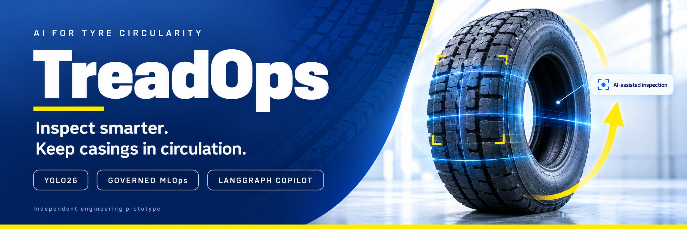
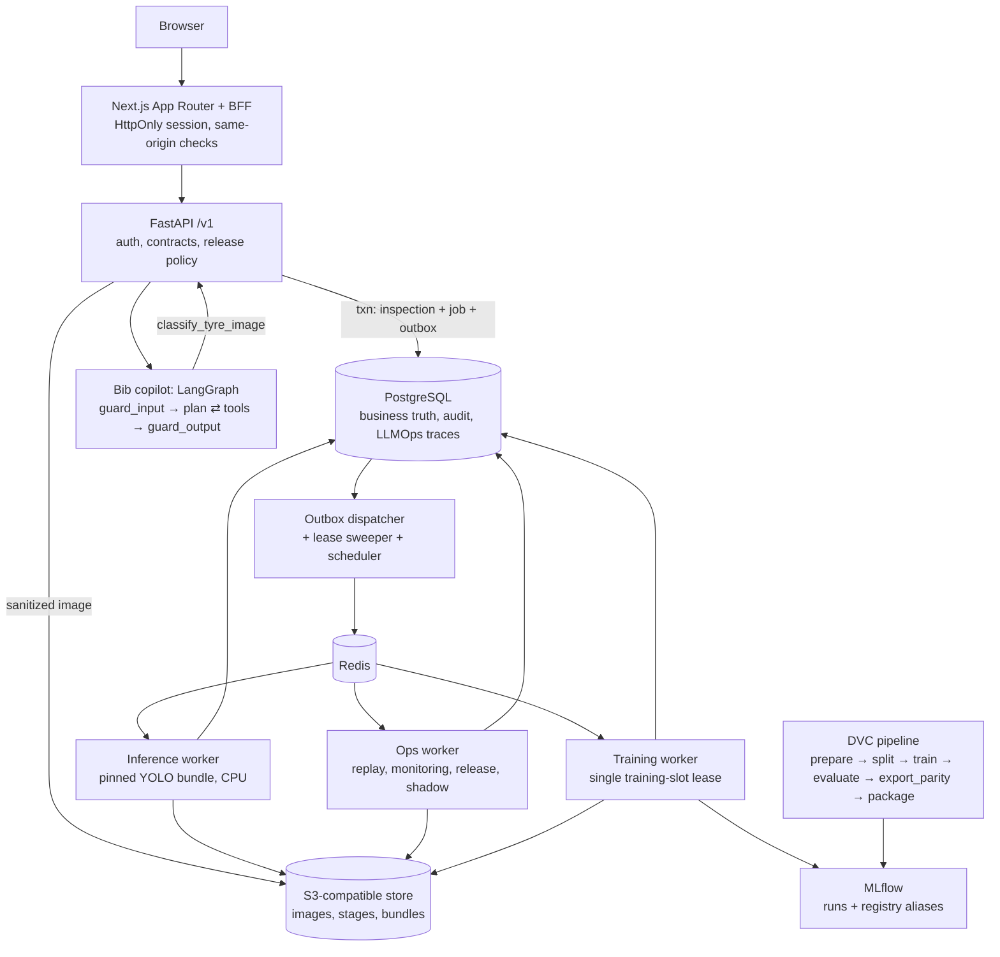

<p align="center">
  
</p>

<p align="center">
  <a href="https://github.com/arav7781/TREADOPS/actions/workflows/ci.yml"></a>
  
  
  
  
</p>

# TreadOps — casing circularity with YOLO26, governed MLOps and a guarded copilot

TreadOps is a **tyre quality-inspection platform**. A photo or short video of a tyre gets a verdict,
**damaged or not damaged**, from an Ultralytics YOLO26 classifier, with an "expert check" flag when the model is
uncertain or the image is poor. Every preprocessing step is shown with its real timing, and a human inspector
gives final clearance. For casings at a retreading operation, the same decision drives a circular pathway
(*retread intake*, *expert inspection* or *end-of-life material recovery*), and a sustainability ledger
estimates the raw material and CO₂e kept in use, counting only **inspector-verified** retreads. Around that sits a complete MLOps loop (DVC, MLflow, gated promotion,
rollback, drift monitoring, operational replay) and a multimodal **LangGraph copilot, "Bib"**, with guardrails and
LLMOps tracing. Inspection happens inside the chat: the photo goes to Bib, and Bib's YOLO tool runs the pipeline.

> Independent engineering prototype by Arav Saxena (23070126018) and Mahi Laddha (23070126069), SIT Pune —
> AI & Machine Learning. Inspired by public descriptions of Michelin's TreadVision AI casing inspection
> (March 2026). It uses public photographs and explicitly simulated operational metadata; **no Michelin
> production data is used** and nothing here describes a Michelin deployment.

## What you can do with it

| Role | Flow |
|---|---|
| Inspector | Open **Bib · Inspect & ask** and attach, drop or paste a tyre photo in the chat. Bib (a LangGraph agent) calls its `classify_tyre_image` tool, which creates a pinned inspection; the chat then shows the agent's steps (guardrails, plan, tool calls, timings) and plays the real pipeline stage by stage: ingest (EXIF orientation, metadata stripped) → canonical image → 224×224 letterbox (padding tinted; no centre crop) → R/G/B tensor planes → image-quality screen → YOLO inference with calibrated probability → occlusion heatmap → annotated **classified image**. The result card, circular pathway, grounded answer and follow-up suggestions follow, and the inspector can record a review without leaving the chat. |
| Inspector (video) | Attach a short clip, or record with the phone/webcam camera, of the tyre turning. The browser scores every sampled frame and sends only the sharpest well-exposed frame per sector of the turn (duplicates dropped); each frame becomes its own pinned inspection, and the **tyre verdict** is conservative: damaged if any frame is damaged, with the decisive frame's full pipeline shown. |
| Line QC | Register RTSP cameras under **Operate → Cameras**: live view, last-hour damaged / not damaged / expert-check counts, *Inspect now*. A connector process inspects the sharpest frame whenever a new tyre is in view. Ask Bib "How are the line cameras doing?" or "What does Line 1 see right now?". |
| Anyone | Ask Bib about the cameras, the model, drift or circularity ("How much CO2 does retreading 25 truck casings save?"). Answers cite the knowledge base and tool outputs and never certify a tyre as safe. Viewers can chat; attaching photos requires the inspector role. |
| ML engineer | Create an eligible snapshot, train an allowlisted recipe, compare gate evidence, run shadow evaluation, run deterministic replays (low light, blur, prior shift, burst), and review drift alerts. |
| Admin | Promote or roll back with a reason and expected generation; audit everything. |

## Measured results (this repository, 2026-10-22/23)

All numbers below come from saved runs in `docs/evidence/`; the targets are the blueprint's proposed goals.

**Data (Mendeley D1, doi:10.17632/bn7ch8tvyp.1, CC BY 4.0).** The archive holds 1,856 image members: 28 are
byte-identical copies, leaving **1,828 unique photos** (1,000 defective, 828 good), all matching the
publisher's SHA-256. A visual review of duplicate candidates (ADR 0003) grouped re-photographed tyres into
**948 label-pure groups**, split 69.8 / 15.0 / 15.2 with zero shared hashes or groups across roles.

**Models** (same split; gates on the outer-validation "gate cohort" = development evidence):

| | YOLO26n-cls (v1) | YOLO26s-cls (v2) |
|---|---|---|
| Gate defect recall (target ≥ 0.95) | 0.967 (145/150) ✅ | 0.967 (145/150) ✅ |
| Gate specificity (target ≥ 0.90) | **0.896 (112/125) ❌** | 0.920 (115/125) ✅ |
| Hard gates (leakage, lineage, finite, class map, ONNX parity) | all passed | all passed |
| **Gate status** | **failed → cannot be promoted** | **passed → promoted (generation 1)** |
| Locked test recall / specificity | 0.940 (141/150) / 0.906 (115/127) | 0.953 (143/150) / 0.937 (119/127) |
| Defective test tyres routed to auto-clear queue | 6 | 3 |
| Low-light stress recall (brightness × 0.45) | 0.747 | 0.760 |
| ONNX vs native max abs probability error (120 images) | 6.7e-6 | 1.8e-6 |
| Model-only latency p95, CPU, batch 1 (Apple M5) | 15.0 ms | 12.6 ms |
| Trained on | CPU, 26 epochs (DVC pipeline) | MPS, 18 epochs (via the app's training job) |

The nano baseline missing its specificity target is shown as **failed** in the UI, the gate report and MLflow
(`validation_status=failed`); the API refuses to promote it. Low light remains the main weakness of both models,
which is exactly what the monitoring and replay tooling is for.

**Seed variability and shadow evaluation.** A second YOLO26s-cls run (seed 43, v3) also passed every development
gate (recall 0.953, specificity 0.976) and the comparative bound against the champion (recall −1.3 pp, 95 % CI
−4.7 to +1.6). Its locked-test recall, however, was 0.887 (133/150) against v2's 0.953: the 275-image development
cohort cannot separate the two seeds. Shadow evaluation on paired development images showed why: v3 gains
specificity but loses recall under blur (−8.6 pp, CI −19.0 to −0.9) and low light (−11.4 pp, CI −24.6 to 0.0).
v3 was promoted only in an explicitly labelled **release drill** (generation 2) and rolled back to v2
(generation 3) citing that evidence; inspections taken in between keep their v3 lineage.

**Vision second opinion (a safety net for auto-clears).** D1's "defective" photos are mostly aged, cracked
rubber, so YOLO learned "new-looking rubber = good": a new tyre with a fresh sidewall gash scored p(defective)
0.124 and was auto-cleared. Its embedding distance (0.38) is inside the training distribution (p99 0.51), so an
out-of-distribution gate would not catch it either. With `VISION_CHECK_MODEL` set, a vision LLM re-checks every tyre
YOLO would auto-clear; when it sees damage with medium or high confidence (or gives no usable answer) the tyre goes
to an expert instead, and the result shows **Uncertain · expert check** with its findings. Measured with
`scripts/eval_vision_check.py` (YOLO26s-cls v2, `gpt-4o-mini`, prompt v1; `docs/evidence/vision_check/`):

| | Validation (calibration + policy) | Locked test |
|---|---|---|
| Defective tyres auto-cleared, YOLO alone | 4 / 150 | 3 / 150 |
| Defective tyres auto-cleared, with second opinion | **3 / 150** | **1 / 150** |
| Good tyres sent to an expert by the second opinion | 22 / 114 auto-cleared (19 disagreements, 3 unusable answers) | 27 / 116 (24 + 3) |
| Added latency per auto-clear (p50) | 2.5 s | 2.4 s |

The cost is roughly one in five clean tyres going to an inspector. The real fix is training data with localized
damage on new tyres (cuts, punctures, bulges): label such inspections "defective" in the review queue so they can
enter a future dataset snapshot, or add a licensed dataset.

**Serving (real photo, end to end):** warm YOLO inference 7–13 ms; whole worker job incl. preprocessing,
occlusion attribution and stage images ≈ 0.3–0.6 s.

**Load (2 req/s for 5 min, Apple M5, single dev API process, CPU inference):** 600/600 accepted, acceptance
p50 53 ms / p95 123 ms / p99 176 ms (target p95 < 1 s ✅), 600/600 completed (target ≥ 99 % ✅). A burst of 180
simultaneous uploads first produced 150 client timeouts and no 429s ❌; after adding an in-flight upload cap it
returns 8 accepted and 172 immediate 429s with `Retry-After` (p95 248 ms) ✅.

**Drills:** restart drill (inference worker paused 30 s, Redis restarted under 2 req/s load): 300/300 accepted
(p95 73 ms), every inspection reached a terminal state, zero duplicate predictions, no stuck outbox events or
orphaned leases ✅. Backup/restore
drill: Postgres restored into a scratch database with the active bundle and sampled inspection media all
resolvable ✅.

**Drift (seed-42 low-light replay, 800 events, simulated metadata):** brightness PSI rose 0.035 → 0.27 → 0.93 →
2.07 across consecutive windows; alerts opened only after two windows above 0.20 and duplicates merged. Mean
p(defective) fell 0.53 → 0.44 as images darkened, matching the stress-test recall drop.

**Tests:** 92 unit, 9 data/ML (on the real data and artifacts) and 34 integration tests against real
PostgreSQL/Redis/object storage (API-01..04, JOB-01..04, REL-01..04, DB-01, cameras, vision second opinion and regressions), 46 web
component tests and 22 Playwright journeys against the live stack and the configured LLM (including video upload and
live-camera recording through Chromium's fake camera) — all passing; GitHub CI (lint, mypy, contract diff,
migrations, tests, web build, Docker images) is green.

## Architecture



Key properties: an inspection is accepted (202) only after the sanitized image and the inspection + job +
outbox rows are committed, and it is **pinned to the deployment generation at acceptance**, so a promotion can
never change a queued job. Celery delivery is at-least-once; SQL compare-and-set claims make every job
idempotent. Promotion stages the bundle by SHA, verifies every file hash, replays a golden batch, then switches
the pointer with an expected-generation compare-and-swap; MLflow's `champion` alias is reconciled afterwards by
a retried job.

## Quick start

Requirements: Docker (Compose v2 or `docker-compose`), Python 3.11 with `uv`, Node 22+.

```bash
make env            # .env with locally generated secrets (never committed)
make bootstrap      # uv sync --locked + npm ci
make infra migrate seed-demo
make fetch-data     # or: make prepare-data ARCHIVE=/path/to/bn7ch8tvyp-1.zip
make prepare-data register-data
make pipeline       # dvc repro: train → evaluate → export_parity → package (+ MLflow registration)
make import-bundle  # promote it from Models (admin) only if its gates pass
make dev            # API :8000, workers, web on http://localhost:3100
```

Demo users are `viewer@`, `inspector@`, `mlengineer@` and `admin@treadops.local`; the password is
`DEMO_PASSWORD` in `.env`. `make up` runs everything in containers instead (CPU profile).

### Bib (copilot) LLM

Bib is **LLM-only**: every answer and follow-up suggestion is written by the model, which fetches facts with
tools (the YOLO inspection tools, model evidence, drift, knowledge base). Set `LLM_BASE_URL`, `LLM_API_KEY` and
`LLM_MODEL` in `.env` (git-ignored; never in `.env.example`, which CI checks) for any OpenAI-compatible endpoint
(OpenAI, Azure OpenAI, a LiteLLM gateway, vLLM, Ollama `/v1`). Without them the chat refuses with
`llm_not_configured`; a failed or filtered model call is retried once and then shown as an error, never replaced
by a templated answer. Guardrails still run on both sides as safety checks. The system prompt is versioned in
`configs/prompts/`; `make eval-copilot` runs the golden set against the configured model and logs to MLflow
(prompt v6 with the current guardrails: 15/15 with `azure/deepSeek-V4-Flash`; v5 also 15/15 on two consecutive runs).

### Name and visual design

The copilot is called **Bib**, a nod to Bibendum, the Michelin Man. The UI follows the visual language of
michelin.in: black header with dropdown navigation and a yellow call to action, navy rounded panels with yellow
round arrows, a blue statement band, heavy italic upper-case headlines, and the palette blue `#27509b`, navy
`#00205b`, yellow `#fce500`. Body text is Noto Sans (as on michelin.in) and headlines use Exo 2, an open-source
stand-in for Michelin's proprietary display face. TreadOps uses no Michelin logo, mascot artwork or proprietary
typeface, and is not affiliated with or endorsed by Michelin.

## Line cameras (RTSP)

```bash
scripts/dev.sh up cameras                 # the connector: one reader per enabled camera
python scripts/sim_cameras.py up          # optional: two simulated RTSP cameras (MediaMTX in Docker + ffmpeg)
python scripts/sim_cameras.py clip        # optional: a turning-tyre clip for the chat's video upload
```

Add cameras in **Operate → Cameras** (ML engineer): *Test connection* grabs a frame before saving. Stream URLs are
encrypted at rest and shown masked. In the default `on_change` mode a camera is inspected at most every
`interval_s`, and only when the scene changed since its last capture (a heuristic: there is no separate tyre
detector), using the sharpest well-exposed frame of that interval. Captures are normal inspections
(`source=camera`, `camera_id`, `line_id`; `metadata_origin=simulated` for test streams), so they appear in
Inspections, Reviews and Monitoring. The simulated streams replay validation photos and are labelled simulated.

## Sustainability ledger

Factors come from Michelin's published truck/bus retreading figures: one MICHELIN Remix retread needs about
50 kg less raw material than a new tyre, and Michelin's internal cradle-to-gate LCA puts the saving at 2.3 kg CO₂
per kg of raw material ([source](https://business.michelin.co.uk/help-advice/truck/tyre-basics-tyre-retreading)).
TreadOps multiplies these by **inspector-verified** retread dispositions only and labels every figure an
estimate. Model recommendations are reported separately.

## Repository map

```
apps/web/                 Next.js UI + BFF
services/api/             FastAPI app, SQL models, services, CLI
services/worker/          Celery runner, dispatcher, job handlers
packages/treadops_ml/     data, transforms, train, evaluate, parity, bundle, monitoring, replay
packages/treadops_agent/  LangGraph copilot, guardrails, tools, tracing, evals
configs/                  data, split, recipes, policy, drift, replay, sustainability, copilot, prompts
migrations/               Alembic
tests/                    unit, ml, integration, load (+ web tests in apps/web)
docs/                     adr/, runbooks/, kb/, evidence/, assets/ (README banner)
```

## Limitations

- D1 is phone photography of mixed passenger and commercial tyres, not plant or shearography imagery.
- Same-tyre groups were inferred from visual similarity and capture order; some leakage between visually
  different photos of the same tyre is still possible.
- Labels are image-level. The heatmap is an attribution aid, not a defect location; detection needs a separately
  annotated dataset (blueprint §38).
- Low-light robustness is weak (recall ~0.75 at 45 % brightness).
- D1 has almost no localized damage on otherwise new tyres (fresh cuts, punctures, bulges), so YOLO can auto-clear
  them; the optional vision second opinion catches most of these at the cost of extra expert reviews.
- Training ran on Apple Silicon (MPS) and CPU, not the RTX 4050 profile in the blueprint (ADR 0002).

## Documentation

| | |
|---|---|
| [docs/README.md](docs/README.md) | Index: ADRs, runbooks, evidence, copilot knowledge base |
| [CONTRIBUTING.md](CONTRIBUTING.md) | Setup, ground rules, checks to run, commit and PR conventions |
| [SECURITY.md](SECURITY.md) | Private vulnerability reporting, security controls and known limitations |
| [CODE_OF_CONDUCT.md](CODE_OF_CONDUCT.md) | Contributor Covenant 2.1 |
| [SUPPORT.md](SUPPORT.md) | Where to ask for help |
| [CHANGELOG.md](CHANGELOG.md) | What changed, by version |
| [CITATION.cff](CITATION.cff) | How to cite TreadOps (GitHub shows "Cite this repository") |

## Licence and attribution

TreadOps is licensed under the **GNU Affero General Public License v3.0 only**: see [LICENSE](LICENSE). Ultralytics
YOLO is AGPL-3.0, which sets the project licence; if you run a modified TreadOps as a network service, AGPL section
13 requires you to offer its users the source of your version.

- [NOTICE.md](NOTICE.md): copyright, third-party components, fonts, data attribution and trademarks.
- [docs/licenses/](docs/licenses/README.md): every runtime dependency and its licence, generated from the lock files
  (`make licenses`).
- Dataset: Pathmanaban P. et al., "Digital images of defective and good condition tyres", Mendeley Data V1,
  doi:10.17632/bn7ch8tvyp.1, CC BY 4.0. The images are not stored in this repository.
- Not affiliated with or endorsed by Michelin. MICHELIN and Bibendum are trademarks of Compagnie Générale des
  Établissements Michelin.
